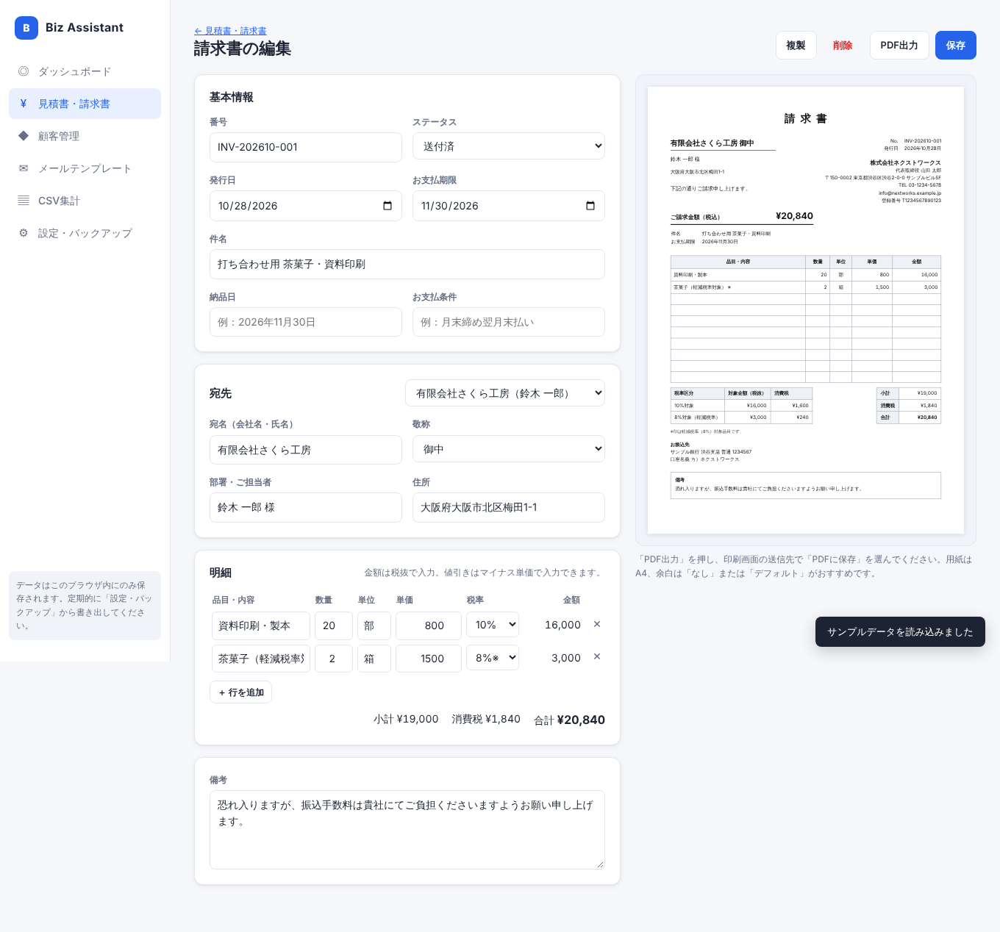
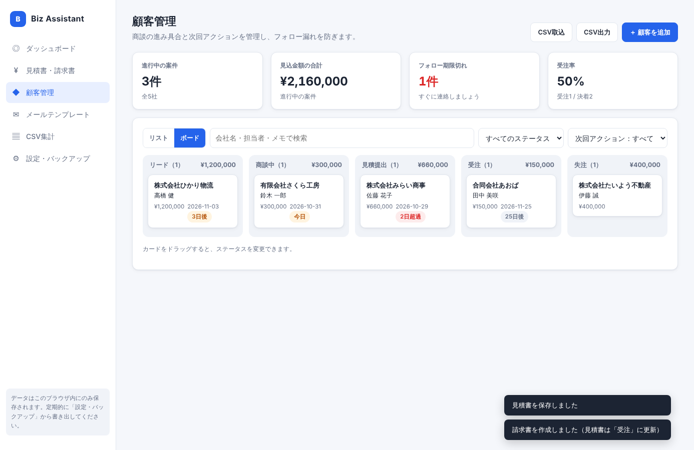
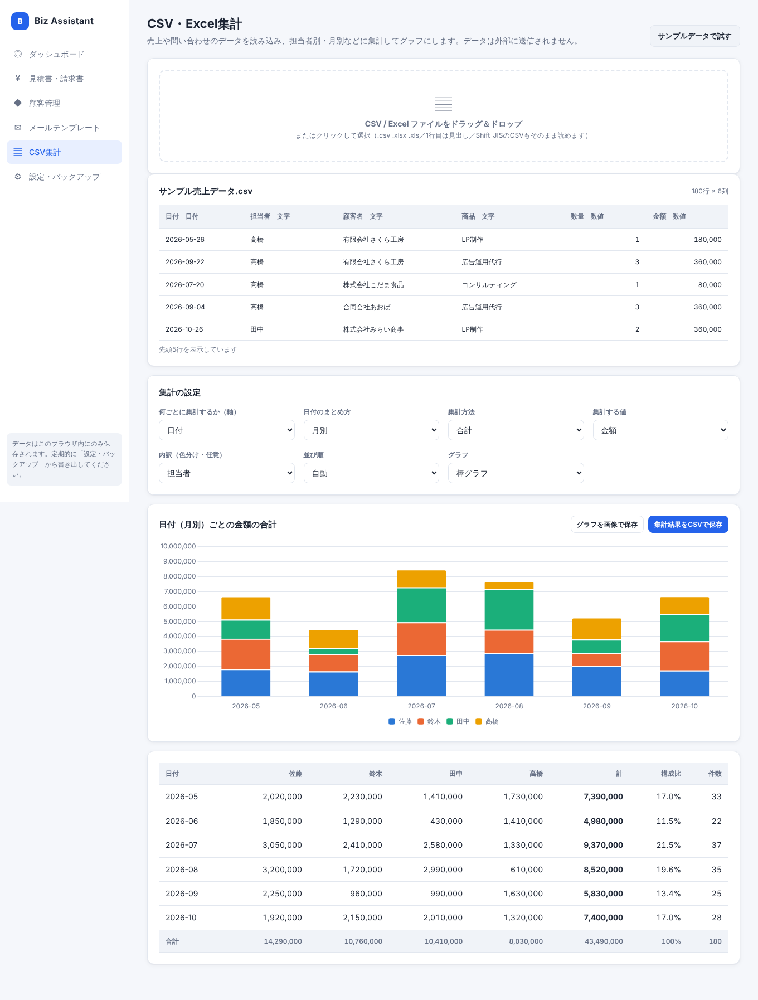
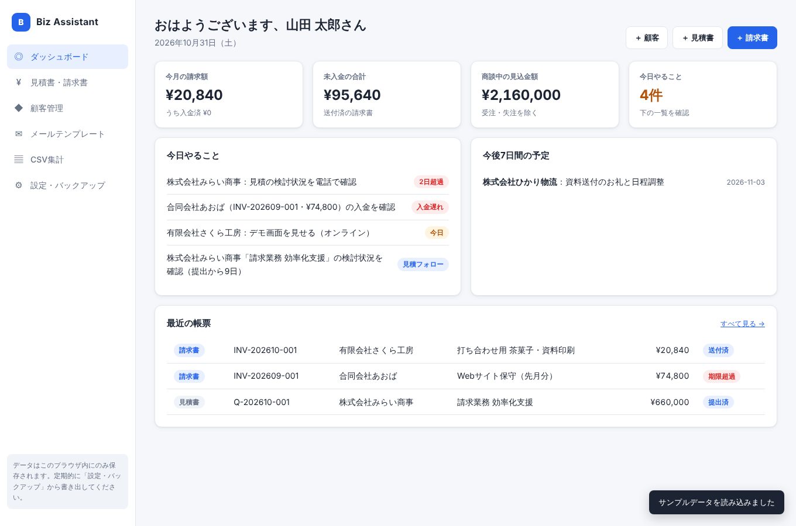

# Biz Assistant（ビズ アシスタント）

事務・営業担当者のための、**ブラウザだけで動く業務アシスタント**です。
見積書・請求書・納品書・領収書の作成、顧客管理、メールの定型文、CSV/Excel の集計を、ひとつのアプリでこなせます。

- **インストール不要・無料**：Webページを開くだけで使えます
- **データは端末の中だけ**：入力した内容は外部のサーバーに送信されません（ブラウザの IndexedDB に保存）
- **インボイス制度に対応**：登録番号の印字、税率ごとの合計と消費税額の表示、1枚につき税率ごとに1回の端数処理



## 主な機能

### 1. 見積書・請求書・納品書・領収書（PDF出力）
- 入力しながら、右側に A4 のプレビューがリアルタイムで表示されます
- 税率 10%／8%（軽減税率）／非課税を明細行ごとに指定。値引きはマイナス単価で入力
- 見積書から **ワンクリックで請求書・納品書を作成**（見積書のステータスは自動で「受注」に）
- 請求書から **領収書・納品書を作成**（領収書を作ると請求書は自動で「入金済」に）
- 領収書は「但し書き」と、税抜5万円以上のときに **収入印紙の貼付欄** を表示
- **品目マスタ**：よく使う商品・サービスを登録しておけば、明細で品名を選ぶだけで単価・単位・税率が入ります（CSV で一括登録も可能）
- 番号の自動採番（例：`INV-202611-001`）、複製、一覧の CSV 出力
- 未入金と支払期限超過を一覧とダッシュボードで表示
- 角印の画像を登録すると、社名に重ねて印字されます

### 2. 顧客管理（簡易CRM）


- ステータス（リード → 商談中 → 見積提出 → 受注／失注）を **リスト** と **ボード（ドラッグで移動）** で管理
- 「次回アクション日」を設定すると、期限切れや当日分を自動で表示
- 電話・訪問・メールなどの活動履歴、関連する見積書・請求書を顧客ごとに表示
- Excel の顧客リストを CSV で一括取り込み（取り込み用のひな形をダウンロードできます）

### 3. メールテンプレート
- 「初回面談のお礼」「見積書の送付」「請求書の送付」など、6種類の文面を最初から用意しています
- `{{会社名}}` や `{{担当者名}}` などを顧客情報から自動で差し込み、ワンクリックでコピー
- `{{訪問日}}` のように好きな名前の項目を書くと、手入力の欄が自動で出てきます
- 送信した記録を顧客の活動履歴に残せます

### 4. CSV・Excel 集計


- `.csv` `.xlsx` `.xls` をドラッグ＆ドロップするだけ（Shift_JIS の CSV もそのまま読めます）
- 「月別×担当者別の売上合計」のようなクロス集計と、棒グラフ・折れ線グラフ・円グラフ
- 集計結果を CSV（Excel で文字化けしない形式）、グラフを PNG 画像で保存

### ダッシュボード


今日やること（期限切れのフォロー、入金遅れ、返事待ちの見積）、今月の請求額、未入金の合計、商談中の見込金額をまとめて表示します。

## 使い方

### すぐに試す
1. 公開 URL を開くか、`index.html` をダブルクリックして Chrome / Edge で開きます
2. ダッシュボードの **「まずはサンプルデータで試す」** を押します
3. 見積書・顧客・メールの各画面を見てみてください

### 実際に使い始める
1. **設定・バックアップ** で会社名、インボイス登録番号、振込先、あなたの名前を登録します
2. **顧客管理** で取引先を登録します
3. **見積書・請求書** で帳票を作成し、「PDF出力」を押します。印刷画面の送信先で **「PDFに保存」** を選んでください

> **大切なこと：バックアップ**
> データはお使いのブラウザの中だけに保存されます。ブラウザの履歴やサイトデータを消去すると、データも消えます。
> 「設定・バックアップ」の **「すべてのデータを書き出す」** で、定期的に JSON ファイルを保存してください。別の PC にデータを移すときにも使えます。

## GitHub Pages で公開する

1. このリポジトリの **Settings → Pages** を開きます
2. Source を **Deploy from a branch**、Branch を `main` と `/ (root)` にして保存します
3. 1〜2分で `https://<ユーザー名>.github.io/<リポジトリ名>/` から使えるようになります

ビルドは不要です。サーバー側の処理もないため、公開しても他の人にあなたのデータが見えることはありません（データはアクセスした人それぞれのブラウザに保存されます）。

## 技術構成

| 項目 | 内容 |
|---|---|
| 言語 | HTML / CSS / JavaScript（フレームワークなし、ビルド不要） |
| データ保存 | IndexedDB（ブラウザ内）、JSON でのエクスポートとインポート |
| PDF | ブラウザの印刷機能（A4 の印刷用 CSS）。文字がきれいで、検索やコピーもできる PDF になります |
| グラフ | [Chart.js](https://www.chartjs.org/) 4.4.1（MIT） |
| Excel 読み込み | [SheetJS Community Edition](https://sheetjs.com/) 0.18.5（Apache-2.0） |

外部ライブラリは `vendor/` に同梱しているため、インターネットに接続していなくても動きます。

```
index.html        画面の骨組み
css/style.css     デザイン（ライトとダークの両モード、スマホ対応、印刷用レイアウト）
js/db.js          IndexedDB の読み書き、バックアップ
js/util.js        共通処理（日付・金額の書式、モーダル、CSV 出力など）
js/app.js         画面の切り替え（ハッシュルーター）
js/dashboard.js   ダッシュボード
js/documents.js   見積書・請求書・納品書・領収書（税計算、帳票レイアウト、PDF 出力）
js/products.js    品目マスタ
js/customers.js   顧客管理
js/templates.js   メールテンプレート
js/analyze.js     CSV・Excel 集計
js/settings.js    自社情報・帳票設定・バックアップ
js/sample.js      サンプルデータ
```

## 消費税の計算について

適格請求書（インボイス）の記載ルールにあわせ、明細を **税率ごとに合計してから** 消費税を計算し、端数処理は **1枚の書類につき税率ごとに1回** だけ行います（端数処理の方法は、切り捨て・四捨五入・切り上げから設定で選べます）。
明細行ごとに消費税を計算して合計する方法とは、金額が数円ずれる場合があります。

## ライセンス

MIT License
